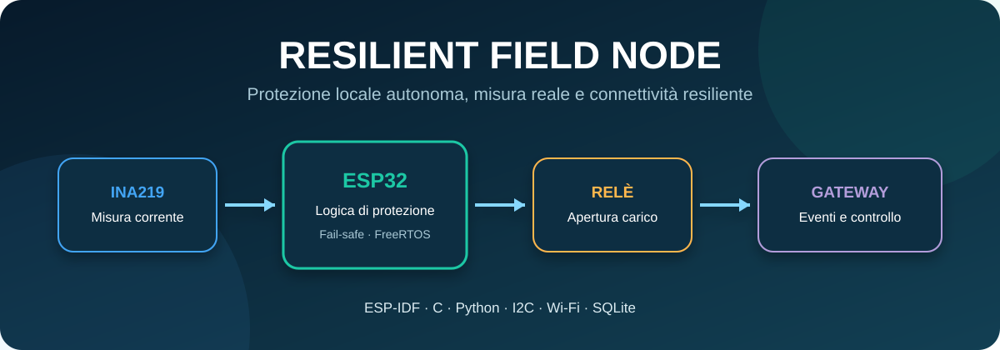
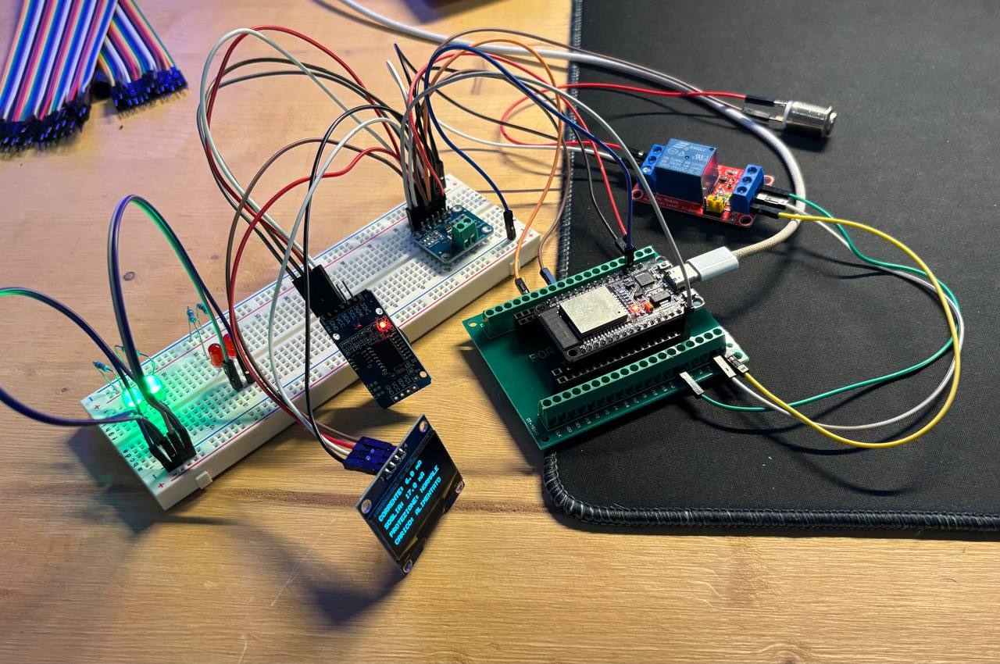
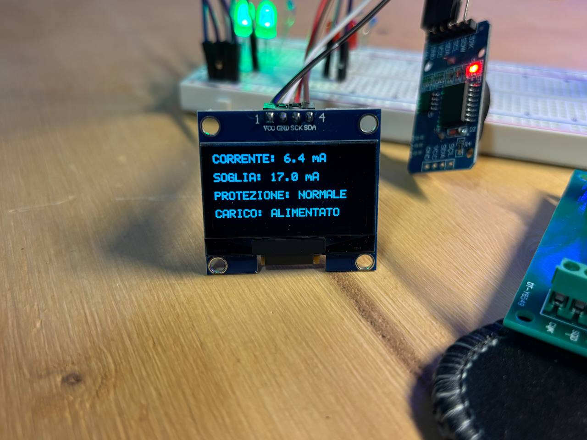
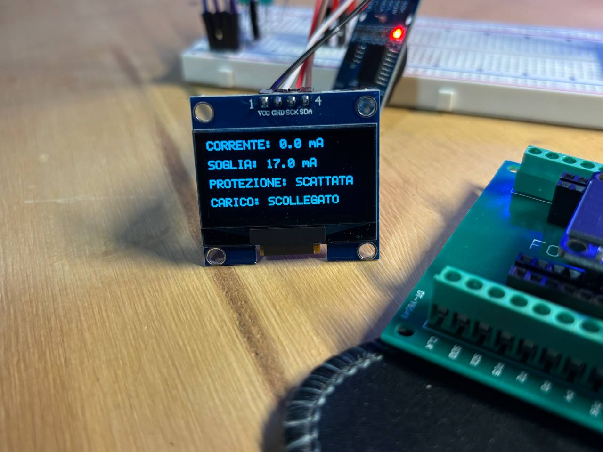
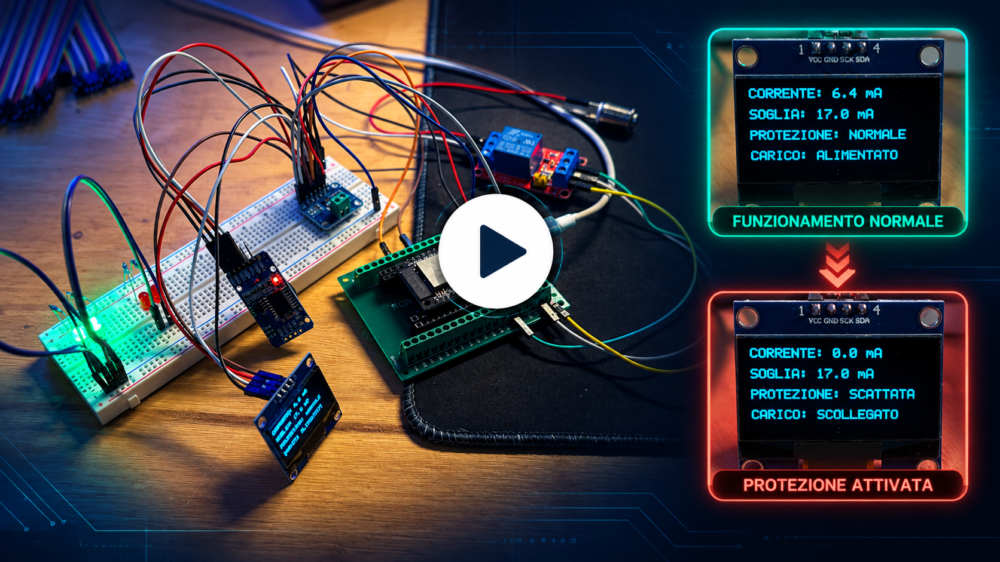
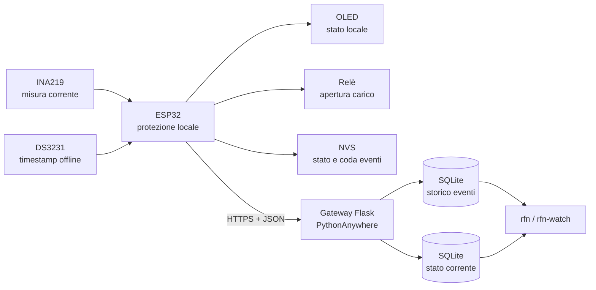

# Resilient Field Node

<p align="center">
  
</p>

<p align="center">
  Nodo di campo basato su ESP32 con misura reale della corrente, protezione locale fail-safe, persistenza degli eventi e sincronizzazione resiliente con un gateway Python online.
</p>

## Stato del progetto

Il proof of concept è completo e verificato end-to-end: dal sensore e dal relè reali fino al gateway Flask pubblicato su PythonAnywhere e al database SQLite.

| Area | Stato finale |
|---|---|
| Modello e simulazione Python | Implementati, `18/18` test superati |
| Logica di protezione C | Implementata e verificata |
| Firmware ESP32 | Implementato e provato sull'hardware reale |
| Persistenza locale NVS | Implementata, compresa la gestione della coda piena |
| Sincronizzazione HTTPS | Verificata con il gateway pubblico |
| Gateway Flask e SQLite | Online e verificato |
| Visualizzazione da terminale | Disponibile con `rfn` e `rfn-watch` |

> Il progetto è un dimostratore a bassa tensione. Non è un dispositivo certificato per la rete elettrica o per impieghi industriali.

## Prototipo

<table>
  <tr>
    <td align="center" colspan="2"><br><strong>Prototipo completo</strong></td>
  </tr>
  <tr>
    <td align="center"><br><strong>Funzionamento normale</strong></td>
    <td align="center"><br><strong>Protezione intervenuta</strong></td>
  </tr>
</table>

## Video dimostrativo

<p align="center">
  <a href="https://github.com/MatteoRinicella/Resilient-field-node/issues/1">
    
  </a>
</p>

## Obiettivo

Il nodo deve:

1. acquisire una misura reale di corrente;
2. riconoscere una sovracorrente persistente;
3. aprire localmente il relè senza dipendere dalla rete;
4. conservare stato ed eventi anche in caso di riavvio;
5. continuare a operare quando il gateway non è raggiungibile;
6. sincronizzare stato ed eventi quando la comunicazione ritorna;
7. evitare duplicati anche dopo una ritrasmissione.

La protezione locale appartiene al percorso critico. Wi-Fi e gateway forniscono supervisione e persistenza remota, ma un loro guasto non impedisce l'apertura del relè.

## Architettura



### Flusso di un trip

```text
Misura > soglia per 2 s
        ↓
Trip della protezione
        ↓
Apertura locale del relè
        ↓
Salvataggio NVS come PENDING
        ↓
Invio HTTPS quando la rete è disponibile
        ↓
Salvataggio SQLite e ACK del gateway
        ↓
Evento marcato ACKNOWLEDGED nella NVS
```

## Decisioni progettuali principali

### Protezione locale e fail-safe

- Il relè parte `OPEN` e viene chiuso soltanto dopo la verifica dell'INA219.
- Una sovracorrente deve durare almeno `2 s` prima del trip.
- Il trip resta memorizzato fino a un reset valido.
- Reset del trip e richiusura del relè sono due operazioni separate.
- Un riavvio non equivale a un reset: lo stato viene recuperato dalla NVS.
- Una misura `INVALID` o `STALE` non viene usata per decidere una sovracorrente e impedisce una richiusura non sicura.

### Persistenza prima della trasmissione

Ogni evento viene scritto nella memoria NVS prima di essere inviato. La coda contiene fino a 16 eventi e usa due stati di consegna:

- `PENDING`: ancora da confermare;
- `ACKNOWLEDGED`: registrato dal gateway.

Prima di un nuovo inserimento la coda elimina soltanto gli eventi già `ACKNOWLEDGED`. Gli eventi `PENDING` non vengono sovrascritti per liberare spazio. La sequenza avanza soltanto dopo un salvataggio riuscito.

### Consegna idempotente

Il gateway usa `event_id` come chiave primaria. Se lo stesso evento viene ritrasmesso perché il primo ACK è andato perso, SQLite non crea una seconda riga ma il gateway restituisce nuovamente l'ACK.

La combinazione `device_id`, `boot_id` e `sequence` è inoltre vincolata come identità logica dell'evento.

### Stato corrente separato dallo storico

- `POST /state` aggiorna una sola riga per dispositivo tramite `UPSERT`;
- `POST /events` conserva lo storico dei trip senza sovrascriverlo.

Alla riconnessione il nodo invia prima lo snapshot autorevole dello stato corrente e poi gli eventi arretrati. Se lo stato cambia mentre una richiesta è in corso, l'ACK del vecchio snapshot viene riconosciuto come superato e il nuovo stato viene ritrasmesso.

## Hardware

| Componente | Collegamento ESP32 | Funzione |
|---|---|---|
| Relè 5 V | `GPIO27` | Apertura e chiusura del carico |
| Pulsante BOOT | `GPIO0` | Comando locale di reset/richiusura |
| Bus I2C SDA | `GPIO21` | Dati per INA219, OLED e DS3231 |
| Bus I2C SCL | `GPIO22` | Clock per INA219, OLED e DS3231 |
| INA219 | I2C `0x40` | Misura della corrente |
| OLED 128x64 | I2C `0x3C` | Corrente, soglia, trip e stato carico |
| DS3231 | I2C `0x68` | Timestamp disponibili anche offline |

Il carico dimostrativo a LED usa una soglia di `17 mA`. Il relè viene aperto quando la corrente resta oltre soglia per `2 s`.

## Firmware ESP32

Il firmware usa ESP-IDF 6.1 e implementa:

- acquisizione reale dall'INA219;
- protezione di sovracorrente indipendente dalla rete;
- comando fisico del relè;
- display OLED e RTC DS3231 sullo stesso bus I2C;
- sincronizzazione NTP con gestione automatica `CET/CEST`;
- timestamp ISO 8601 con offset;
- persistenza di trip, relè, sequenza e coda eventi nella NVS;
- ordinamento FIFO degli eventi `PENDING`;
- gestione idempotente degli ACK duplicati;
- compattazione degli eventi già confermati;
- attività Wi-Fi/HTTPS separata dal ciclo di protezione;
- autenticazione Bearer e validazione del certificato HTTPS;
- snapshot dello stato inviato prima dello storico;
- controllo seriale USB quando i pulsanti della scheda non sono accessibili.

### Comandi seriali USB

Con il monitor ESP-IDF aperto:

- `reset`: rimuove un trip valido e lascia il relè aperto;
- `close`: richiude soltanto con trip disattivato e corrente sicura;
- `restart`: riavvia il firmware senza cancellare la NVS.

La sequenza normale dopo un intervento è: rimuovere la sovracorrente, inviare `reset`, quindi inviare `close`.

## Software Python

La parte Python è organizzata in livelli distinti:

| Modulo | Responsabilità |
|---|---|
| `domain/` | Misure, qualità, protezione, breaker, eventi e stati operativi |
| `node.py` | Coordinamento tra protezione, interruttore e persistenza |
| `synchronization.py` | Invio degli eventi pendenti e applicazione degli ACK |
| `gateway.py` | Gateway simulato per test deterministici offline/online |
| `sqlite_event_store.py` | Persistenza SQLite del nodo simulato |
| `gateway_server.py` | API HTTP Flask pubblicata online |
| `sqlite_gateway_event_store.py` | Storico idempotente degli eventi ricevuti |
| `sqlite_gateway_state_store.py` | Ultimo snapshot di ogni dispositivo |
| `show_gateway_data.py` | Visualizzazione dello stato e degli eventi da terminale |

La simulazione Python usa una soglia configurabile nel file `config/node.toml`; il valore di `17 mA` appartiene invece alla configurazione del prototipo hardware.

## Gateway online

Il gateway Flask è pubblicato su PythonAnywhere:

- [`GET /health`](https://mrculino.eu.pythonanywhere.com/health): verifica diagnostica del servizio;
- `POST /state`: ricezione dello snapshot corrente;
- `POST /events`: ricezione idempotente degli eventi.

Le richieste `POST` richiedono un token Bearer. Il server:

1. rifiuta le richieste se il token non è configurato;
2. confronta l'header con `secrets.compare_digest`;
3. valida JSON, tipi, timestamp e invarianti di dominio;
4. usa query SQL parametrizzate;
5. completa il commit SQLite prima di restituire l'ACK;
6. restituisce `duplicate: true` quando l'evento era già presente.

Il database è conservato fuori dal repository in:

```text
~/.resilient-field-node/gateway-events.sqlite3
```

Contiene due tabelle principali:

- `received_events`: storico append-only dei trip;
- `current_node_state`: ultimo stato noto, una riga per `device_id`.

## Visualizzazione da terminale

Dalla directory del progetto:

```bash
python scripts/show_gateway_data.py
python scripts/show_gateway_data.py --watch
```

Su PythonAnywhere sono disponibili gli alias:

```bash
rfn
rfn-watch
```

`rfn` mostra una singola lettura. `rfn-watch` aggiorna ogni cinque secondi stato della protezione, posizione del relè, ultima sequenza e ultimi dieci eventi. Si interrompe con `Ctrl+C`.

## Installazione Python

Requisiti: Python 3.12 o successivo.

```powershell
python -m venv .venv
.\.venv\Scripts\Activate.ps1
python -m pip install --editable .
```

### Test automatici

```powershell
python .\scripts\run_all_tests.py
```

Risultato verificato:

```text
Test superati: 18 / 18
Tutti i test sono stati superati
```

La suite comprende test unitari e di integrazione per soglia, ritardo, qualità della misura, trip, reset, richiusura, persistenza SQLite, deduplicazione e sincronizzazione dopo una disconnessione.

### Simulazione completa

```powershell
python .\scripts\measurement_example.py
```

La simulazione mostra gateway offline, trip locale, persistenza dell'evento, riconnessione, sincronizzazione, ACK, reset e richiusura controllata.

## Test e simulazione C

```powershell
gcc -I ".\c\include" ".\c\tests\test_resilient_field_node.c" ".\c\src\resilient_field_node.c" -Wall -Wextra -std=c11 -o ".\c\build\test_resilient_field_node.exe"
.\c\build\test_resilient_field_node.exe
```

Per eseguire la simulazione C:

```powershell
gcc -I ".\c\include" ".\c\src\main.c" ".\c\src\resilient_field_node.c" -Wall -Wextra -std=c11 -o ".\c\build\main.exe"
.\c\build\main.exe
```

## Compilazione e caricamento ESP32

Il progetto ESP-IDF si trova in `firmware/esp32`.

1. Aprire `firmware/esp32` come directory del progetto ESP-IDF.
2. Selezionare il target `esp32` e la porta seriale rilevata sul computer.
3. Configurare la sezione **Resilient Field Node** con **ESP-IDF: SDK Configuration Editor**.
4. Usare **Build Project** per compilare.
5. Usare **Build, Flash and Monitor** per caricare e aprire il monitor seriale.

SSID, password Wi-Fi, URL del gateway e token API sono configurazioni locali contenute in `sdkconfig`, escluso da Git.

## Struttura del repository

```text
config/
    node.toml

scripts/
    gateway_server.py
    measurement_example.py
    run_all_tests.py
    show_gateway_data.py

src/resilient_field_node/
    configuration.py
    gateway.py
    node.py
    synchronization.py
    domain/
    storage/

tests/
    unit/
    integration/

c/
    include/resilient_field_node.h
    src/
    tests/

firmware/esp32/
    CMakeLists.txt
    main/
        esp32.c
        event_storage.c
        gateway_client.c
        network_time.c
        node_event.h
        oled_display.c
        rtc_ds3231.c
        wifi_connection.c

docs/images/
```

## Verifiche end-to-end completate

- Trip reale oltre `17 mA` dopo `2 s` e apertura fisica del relè.
- Recupero di trip, stato del relè, sequenza e coda dopo il riavvio.
- Protezione locale operativa durante connessione Wi-Fi e richieste HTTPS.
- Invio FIFO degli eventi persistenti al gateway pubblico.
- ACK applicativo soltanto dopo il salvataggio SQLite.
- Nessun duplicato in seguito a una ritrasmissione.
- Snapshot aggiornato prima dello storico arretrato.
- Rilevamento di uno stato cambiato durante una richiesta in corso.
- Compattazione della coda dopo la riproduzione reale della saturazione a 16 eventi.
- Comandi USB `reset`, `close` e `restart` verificati con la scheda nel contenitore.
- Visualizzazione online verificata con `rfn` e `rfn-watch`.

## Sicurezza e configurazione

- Le credenziali non sono incluse nel repository.
- `sdkconfig`, database locali, ambienti virtuali e configurazioni VS Code specifiche del computer sono ignorati da Git.
- Il token del gateway viene letto da una variabile d'ambiente.
- L'ESP32 valida il certificato TLS tramite il bundle ESP-IDF.
- Le query SQLite usano parametri separati dai dati ricevuti.

Per un prodotto reale sarebbero necessari token distinti per dispositivo o mutual TLS, rotazione delle credenziali, autorizzazione granulare e monitoraggio centralizzato.

## Limiti e sviluppi futuri

- evento diagnostico persistente per misure `INVALID` o `STALE`;
- stato operativo `DEGRADED` completo;
- controllo lato gateway contro snapshot arrivati fuori ordine;
- identificatori robusti anche dopo una cancellazione totale della NVS;
- parser JSON completo della risposta sul firmware;
- calibrazione metrologica dell'INA219;
- test di durata, fault injection e validazione dei tempi real-time;
- integrazione Ethernet W5500;
- hardware, isolamento e certificazioni per applicazioni industriali.

## Risultato

Il progetto dimostra un flusso completo e resiliente: misura reale, decisione locale, apertura fail-safe, persistenza embedded, sincronizzazione sicura, deduplicazione server, archiviazione relazionale e consultazione remota. La perdita della rete riduce temporaneamente la visibilità, ma non interrompe la funzione di protezione.
